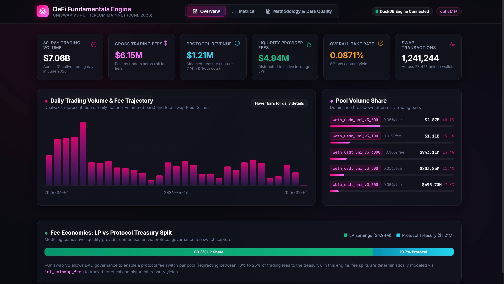
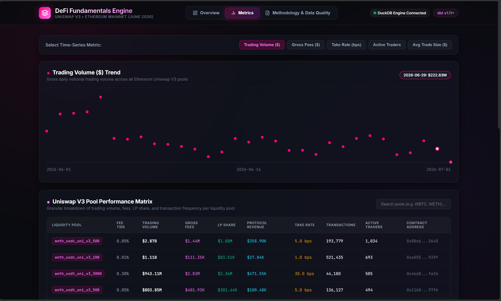
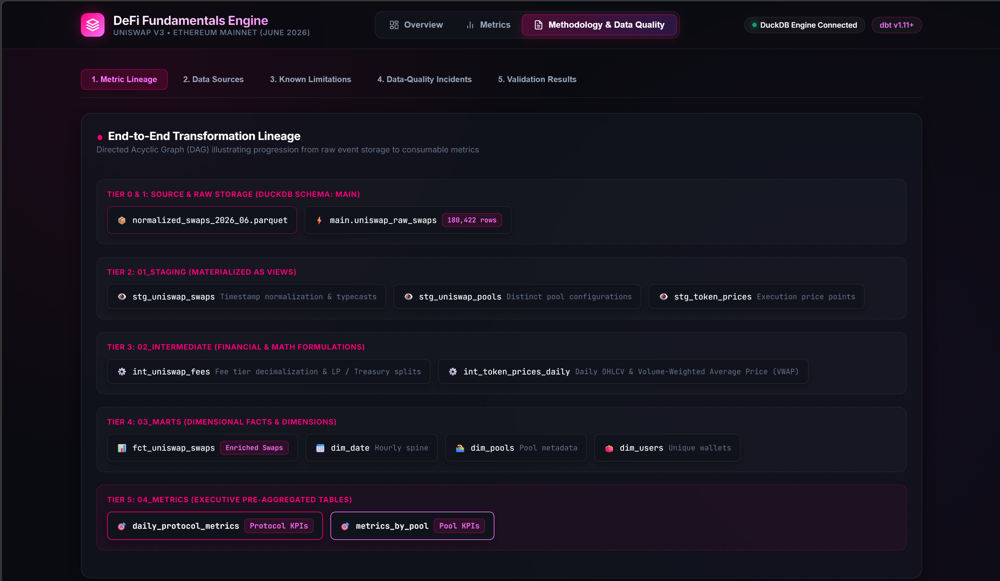

# DeFi Fundamentals Engine — Methodology & Metric Dictionary: Uniswap V3

**Project Name:** DeFi Fundamentals Engine  
**Protocol 1:** Uniswap V3 *(Implemented & Tested)*  
**Protocol 2:** Aave V3 *(Planned / Research Completed — see [Protocol Research](../research/protocols.md))*  

---

## 1. Project Objective

The **DeFi Fundamentals Engine** transforms raw, highly granular, on-chain execution logs into standardized, auditable, and reproducible financial and operational metrics for decentralized finance (DeFi) protocols. 

Traditional off-chain financial analytics rely on consolidated accounting statements, whereas DeFi fundamentals are continuously emitted as immutable smart contract state transitions. However, raw EVM event logs present several analytical hurdles:
- Log indices and arbitrary uint256 fixed-point representations require precision normalization.
- In multi-asset liquidity pools, volume and fee economics require robust dollar-denominated valuations without double-counting swap legs.
- Concentrated liquidity dynamics (virtual reserves, ticks, and governance fee switches) require protocol-accurate accounting to differentiate between gross trading fees, liquidity provider (LP) accrued earnings, and protocol-level treasury revenue.

This engine provides a reproducible ELT data pipeline using **DuckDB** and **dbt** to ingest, standardize, model, and aggregate Uniswap V3 trading data from a defined historical observation window (June 2026 BTC/ETH pairs), accompanied by protocol research on Aave V3 and an optional on-chain extraction workflow for Base and Ethereum.

---

## 2. Tech Stack

| Technology | Layer / Role | Description |
| :--- | :--- | :--- |
| **Python 3.13+ (`uv`)** | Environment & Scripting | Python execution, dependency locking (`uv`), and extraction orchestration. |
| **DuckDB + Parquet** | Storage & Analytical Engine | Embedded vectorized OLAP database providing fast analytical queries over columnar Parquet files. |
| **dbt (`dbt-duckdb`)** | Data Transformation & Testing | Four-layer modular data transformation workflow with automated testing, documentation, and lineage graphs. |
| **Next.js 16 + React 19** | Local Web Dashboard | Interactive analytics dashboard with server-side DuckDB connection, Uniswap V3 design system, and responsive SVG charts. |
| **GitHub** | Version Control | Source code versioning, schema evolution tracking, and collaborative workflow. |
| **Markdown** | Documentation | Standardized technical methodology documentation and metric dictionaries. |
| **Streamlit** | Exploratory UI & Extraction | Interactive interface for CDP-indexed on-chain querying and pipeline monitoring. |

---

## 3. Data Sources & Ingestion Modes

The repository operates in two distinct data modes:

### Mode A: Historical Dataset (Primary Pipeline & Dashboard)
- **Source Dataset:** Sourced from the [Marvin Gonzo Uniswap V3 BTC/ETH dataset](https://www.kaggle.com/datasets/marvingozo/ethereum-uniswap-v3-btceth-june-2026?resource=download) covering Ethereum mainnet for June 2026 (1,567,364 swap logs across 24 active pools).
- **Storage Format:** Columnar Parquet (`normalized_swaps_2026_06.parquet`), located in `extract/data/`.
- **Ingestion Strategy:** Direct DuckDB SQL ingestion via `read_parquet()` into table `uniswap_raw_swaps` within schema `main`.
- **Price Feeds:** Historical execution prices are derived on-chain from pool execution tick and swap ratios (`price_quote`). Integration with off-chain price oracle APIs (e.g., CoinMarketCap / CoinGecko) is planned for external cross-asset benchmark verification.

### Mode B: On-Chain Live Extraction (Optional CLI Tooling)
- **Extractor Engine:** Located in `extract/auto_extractor.py`, querying Coinbase Developer Platform (CDP) indexed APIs via signed Ed25519 JWT authentication.
- **Workflow:** Standalone batch extractor that tracks the maximum `block_number` cursor, pages in 50,000-row batches, deduplicates boundaries in $O(1)$ time, and runs to the chain tip.
- **Scope Distinction:** Used for ad-hoc or targeted extraction; the dbt transformation pipeline and local dashboard currently consume the reproducible Mode A historical snapshot.

### Raw Data Schema (`uniswap_raw_swaps`)

| Column Name | Data Type | Description |
| :--- | :--- | :--- |
| `timestamp_ms` | `BIGINT` | Block timestamp represented in Unix epoch milliseconds. |
| `block_number` | `BIGINT` | EVM block height containing the swap transaction. |
| `tx_hash` | `VARCHAR` | Unique transaction identifier hash. |
| `tx_index` | `BIGINT` | Position of the transaction within the block. |
| `log_index` | `BIGINT` | Log event position within the transaction receipt. |
| `dex` | `VARCHAR` | Decentralized exchange identifier (`uniswap_v3`). |
| `pool_name` | `VARCHAR` | Human-readable pair symbol representation (e.g., `WBTC-WETH`). |
| `pool_address` | `VARCHAR` | Canonical ERC-20 contract address of the liquidity pool. |
| `asset_family` | `VARCHAR` | Category classification of trading pair assets. |
| `base_variant` | `VARCHAR` | Base token asset contract standard/variant. |
| `base_token` | `VARCHAR` | Symbol or contract address of base asset. |
| `quote_token` | `VARCHAR` | Symbol or contract address of quote asset. |
| `fee_tier` | `BIGINT` | Pool fee tier expressed in hundredths of a bip / ppm (e.g., 500, 3000, 10000). |
| `side` | `VARCHAR` | Trade execution direction (`buy` vs. `sell`). |
| `amount_base` | `DOUBLE` | Decimal-adjusted quantity of base tokens transacted. |
| `amount_quote` | `DOUBLE` | Decimal-adjusted quantity of quote tokens transacted. |
| `price_quote` | `DOUBLE` | Unit price of base token quoted in quote token. |
| `volume_usd` | `DOUBLE` | Estimated notional dollar value of the trade execution (single leg). |
| `amount0_raw` | `VARCHAR` | Raw EVM integer delta of token0 from `Swap` event log. |
| `amount1_raw` | `VARCHAR` | Raw EVM integer delta of token1 from `Swap` event log. |
| `sqrt_price_x96` | `VARCHAR` | Post-swap square root price in Q64.96 fixed-point format. |
| `tick` | `BIGINT` | Discrete post-swap price tick index. |
| `pool_liquidity` | `VARCHAR` | Active virtual liquidity ($L$) within the active tick range. |
| `sender` | `VARCHAR` | Address initiating the swap (caller / router contract). |
| `recipient` | `VARCHAR` | Destination address receiving output tokens. |

---

## 4. dbt Architecture & Modeling Pipeline

The dbt transformation layer enforces a structured, four-tier medallion architecture:

```
models/
│
├── 01_staging/        --> Schema: staging      (Materialized as View)
│   ├── __sources.yml
│   ├── schema.yml
│   ├── stg_uniswap_swaps.sql
│   ├── stg_uniswap_pools.sql
│   └── stg_token_prices.sql
│
├── 02_intermediate/   --> Schema: intermediate (Materialized as View)
│   ├── schema.yml
│   ├── int_token_prices_daily.sql
│   └── int_uniswap_fees.sql
│
├── 03_marts/          --> Schema: mart         (Materialized as Table)
│   ├── schema.yml
│   ├── dim_date.sql
│   ├── dim_pools.sql
│   ├── dim_users.sql
│   └── fct_uniswap_swaps.sql
│
└── 04_metrics/        --> Schema: metrics      (Materialized as Table)
    ├── daily_protocol_metrics.sql
    └── metrics_by_pool.sql
```

### Layer Functions & Design Rationale

1. **`01_staging` (Views)**
   - Extracts directly from `source('raw', 'uniswap_raw_swaps')`.
   - Normalizes epoch timestamps (`to_timestamp(timestamp_ms / 1000.0)`).
   - Standardizes naming conventions (e.g. `volume_usd` aliased to `amount_usd`).
   - Deduplicates pools (`stg_uniswap_pools`) and isolates base token price points (`stg_token_prices`).

2. **`02_intermediate` (Views)**
   - Encapsulates complex financial calculations before presentation in marts.
   - **`int_uniswap_fees`**: Translates pool fee tiers (500, 3000, 10000) into decimal multipliers, computes gross fees paid by traders, and models fee splits (allocating standard cuts to pool LPs vs. protocol treasury switch reserves).
   - **`int_token_prices_daily`**: Groups swap prices chronologically to derive Daily Open, High, Low, Close (OHLC), Volume-Weighted Average Price (VWAP), and arithmetic average prices per token pair.

3. **`03_marts` (Tables)**
   - Persistent dimensional models built for business intelligence and ad-hoc SQL querying.
   - **`fct_uniswap_swaps`**: Core atomic swap fact table enriched with fee breakdowns and pool liquidity parameters.
   - **`dim_date`**: Continuous chronological hourly and daily calendar dimension spine generated via `GENERATE_SERIES`.
   - **`dim_pools`**: Entity dimension of unique liquidity pools, fee configurations, and asset pairs.
   - **`dim_users`**: Entity dimension tracking wallet lifecycles (`first_seen_at`, `last_seen_at`, `total_interactions`) across swap senders and recipients.

4. **`04_metrics` (Tables)**
   - Highly consolidated analytical summary tables.
   - **`daily_protocol_metrics`**: Protocol-wide daily aggregations including volume, unique active traders, transaction volume, gross fees, LP payouts, protocol revenue, and take rates.
   - **`metrics_by_pool`**: Granular pool-by-pool daily performance metrics.

---

## 5. Metric Dictionary

The metric dictionary follows a rigorous analytical standard specifying definition, source, grain, calculation formula, and exclusions for every metric produced by the pipeline.

### Metric: Trading Volume

- **Definition:**  
  The total gross notional USD value of executed token swaps routed through Uniswap V3 pools during the measurement period. Each swap represents a single trade event; the calculation evaluates the dollar value of the trade without double-counting both sides of the transaction.
- **Source:**  
  `fct_uniswap_swaps.amount_usd` (derived from `stg_uniswap_swaps.volume_usd`).
- **Grain:**  
  Protocol × Chain × Pool × Day (or aggregate Protocol × Chain × Day).
- **Calculation:**  
  $$\text{Trading Volume} = \sum \text{amount\_usd}$$
- **Exclusions:**  
  Records where `amount_usd IS NULL`, trades with non-positive values (`amount_usd <= 0`), failed EVM transactions (only confirmed event logs are ingested), and test/mock pools without valid price conversions.

---

### Metric: Transaction Count (`tx_count`)

- **Definition:**  
  The distinct count of blockchain transactions containing one or more Uniswap V3 swap executions during the measurement period.
- **Source:**  
  `fct_uniswap_swaps.tx_hash`.
- **Grain:**  
  Protocol × Chain × Day.
- **Calculation:**  
  $$\text{Transaction Count} = \text{COUNT}(\text{DISTINCT } \text{tx\_hash})$$
- **Exclusions:**  
  Duplicate log records within the same transaction hash.

---

### Metric: Active Traders (`active_traders`)

- **Definition:**  
  The count of unique initiating wallet addresses (`sender`) that submitted swap transactions to the protocol within the measurement window.
- **Source:**  
  `fct_uniswap_swaps.sender`.
- **Grain:**  
  Protocol × Chain × Day.
- **Calculation:**  
  $$\text{Active Traders} = \text{COUNT}(\text{DISTINCT } \text{sender})$$
- **Exclusions:**  
  Passive liquidity providers who did not initiate a swap; downstream recipient addresses that did not sign or originate the transaction.

---

### Metric: Gross Trading Fees (`fees`)

- **Definition:**  
  The total gross dollar-denominated transaction fees charged to traders on all executed swaps, calculated according to the configured fee tier of each specific pool contract (e.g. 100, 500, 3000, 10000 ppm / hundredths of a bip).
- **Source:**  
  `fct_uniswap_swaps.total_fee_usd` (derived from `int_uniswap_fees`).
- **Grain:**  
  Protocol × Chain × Day.
- **Calculation:**  
  $$\text{Total Fees} = \sum \left( \frac{\text{fee\_tier}}{1{,}000{,}000} \times \text{amount\_usd} \right)$$
- **Exclusions:**  
  Ethereum network gas fees paid to block builders / validators (gas is an infrastructure cost, not a protocol trading fee).

---

### Metric: Fees Attributable to Liquidity Providers (`lp_fees`)

- **Definition:**  
  The portion of gross swap fees accrued pro-rata to active in-range liquidity providers who supplied capital to the respective pool during swap execution.
- **Accounting Note:**  
  This metric measures **accrued fees** generated at the time of trade execution. It does *not* represent realized wallet transfers or `collect()` claim events. In Uniswap V3, fees accumulate uncollected inside the pool contract until an LP explicitly calls `collect()`.
- **Source:**  
  `fct_uniswap_swaps.lp_fee_usd`.
- **Grain:**  
  Protocol × Chain × Day.
- **Calculation:**  
  $$\text{LP Fees} = \sum \text{CASE WHEN } \text{fee\_tier} \le 500 \text{ THEN } \text{total\_fee\_usd} \times 0.75 \text{ ELSE } \text{total\_fee\_usd} \times \frac{5}{6} \text{ END}$$
- **Exclusions:**  
  Modeled protocol treasury cuts diverted when protocol fee switches are engaged.

---

### Metric: Modeled Protocol Revenue (`protocol_revenue`)

- **Definition:**  
  The theoretical share of swap fees retained by the protocol treasury or governance DAO under standard governance fee-switch parameters.
- **Accounting Note:**  
  Uniswap V3 governance has historically debated and selectively piloted the activation of the protocol fee switch, but it has not been universally activated across mainnet pools. Consequently, this metric is a **modeled / simulated allocation** rather than observed treasury cash flows or token transfers into a DAO wallet.
- **Source:**  
  `fct_uniswap_swaps.protocol_fee_usd`.
- **Grain:**  
  Protocol × Chain × Day.
- **Calculation:**  
  $$\text{Protocol Revenue} = \sum \text{CASE WHEN } \text{fee\_tier} \le 500 \text{ THEN } \text{total\_fee\_usd} \times 0.25 \text{ ELSE } \text{total\_fee\_usd} \times \frac{1}{6} \text{ END}$$
- **Exclusions:**  
  Direct pool distributions retained by liquidity providers.

---

### Metric: Protocol Take Rate (`take_rate`)

- **Definition:**  
  The effective percentage of trading volume captured as gross fees by the protocol and its liquidity providers combined, expressing protocol pricing power and fee tier distribution across pools.
- **Source:**  
  Derived from `daily_protocol_metrics`.
- **Grain:**  
  Protocol × Chain × Day.
- **Calculation:**  
  $$\text{Take Rate} = \frac{\sum \text{total\_fee\_usd}}{\sum \text{amount\_usd}}$$
  - **Expressed In:** Basis points (bps) where $1 \text{ bps} = 0.01\% = 0.0001$, as well as percentage ($0.0871\% = 8.71 \text{ bps}$).
- **Exclusions:**  
  Zero-volume days (protected via `NULLIF(SUM(amount_usd), 0)` to prevent division-by-zero errors).

---

### Metric: Average Trade Size (`avg_trade_size_usd`)

- **Definition:**  
  The average notional USD volume transacted per unique swap transaction.
- **Source:**  
  Derived from `daily_protocol_metrics`.
- **Grain:**  
  Protocol × Chain × Day.
- **Calculation:**  
  $$\text{Average Trade Size} = \frac{\sum \text{amount\_usd}}{\text{COUNT}(\text{DISTINCT } \text{tx\_hash})}$$
- **Exclusions:**  
  Zero-transaction days.

---

### Metric: Volume Per Active Trader (`volume_per_active_trader`)

- **Definition:**  
  The average aggregate notional USD trading volume generated per unique active trader address on a given day.
- **Source:**  
  Derived from `daily_protocol_metrics`.
- **Grain:**  
  Protocol × Chain × Day.
- **Calculation:**  
  $$\text{Volume Per Trader} = \frac{\sum \text{amount\_usd}}{\text{COUNT}(\text{DISTINCT } \text{sender})}$$
- **Exclusions:**  
  Days with zero unique active senders.

---

### Metric: Daily Volume-Weighted Average Price (VWAP)

- **Definition:**  
  The trading benchmark price of a base asset quoted in quote currency, weighted by the base volume executed at each swap price throughout the calendar day.
- **Source:**  
  `int_token_prices_daily.vwap_price`.
- **Grain:**  
  Base Asset × Quote Asset × Calendar Day.
- **Calculation:**  
  $$\text{VWAP} = \frac{\sum (\text{price\_quote} \times \text{amount\_base})}{\sum \text{amount\_base}}$$
- **Exclusions:**  
  Transactions where `price_quote <= 0` or `amount_base <= 0`.

---

## 6. dbt Data Tests & Quality Framework

The pipeline enforces data integrity using automated schema tests configured in YAML files across models:

1. **Uniqueness Constraints (`unique`)**:
   - `dim_pools.pool_address`
   - `dim_users.wallet_address`
   - `dim_date.date_hour`

2. **Null Value Prohibition (`not_null`)**:
   - `stg_uniswap_swaps.block_timestamp`, `block_number`, `tx_hash`, `pool_address`
   - `fct_uniswap_swaps.block_number`, `tx_hash`, `pool_address`
   - `dim_date.date_hour`, `date_day`
   - `dim_users.wallet_address`, `first_seen_at`, `last_seen_at`
   - `int_token_prices_daily.price_date`, `base_token`, `quote_token`

3. **Domain & Value Range Tests**:
   - `price_quote > 0` and `amount_base > 0` enforced in intermediate price modeling.
   - Non-zero denominators safeguarded with DuckDB `NULLIF` operators across metric models.

---

## 7. Known Assumptions & Limitations

1. **Modeled vs. Observed Protocol Revenue**:  
   Uniswap V3 governance has historically retained the capability to activate a protocol fee switch (redirecting 1/4th to 1/6th of LP fees to the DAO treasury), but fee switches are not universally enabled on Ethereum mainnet. In this pipeline, protocol revenue is a **modeled / theoretical simulation** applying governance parameter formulas to demonstrate revenue potential, rather than observed deposits into a DAO treasury contract.
2. **Accrued Fees vs. Realized Wallet Transfers**:  
   `lp_fees` represents the fees accrued pro-rata to in-range liquidity providers during swap transactions. Uniswap V3 fees are not pushed to LP wallets automatically; they remain uncollected inside the pool contract until an LP submits a `collect()` transaction.
3. **Timeframe Boundaries & Data Scope**:  
   The current analytical pipeline and dashboard operate on the June 2026 Ethereum BTC/ETH swap dataset. Metrics reflect this specific 30-day observation window and should be interpreted as historical snapshot metrics rather than a live streaming feed.
4. **Price Conversion Scope**:  
   USD volumes are derived from on-chain pool execution ratios at the time of the swap (`price_quote`). Highly exotic pairs without stable/ETH pairings require external oracle valuation (planned via CoinMarketCap API).

---

## 8. Dashboard Implementation & User Interface

The **DeFi Fundamentals Engine** features a dedicated Next.js web application located in the [`dashboard/`](../../dashboard) directory. Built with **Next.js 16**, **React 19**, and native **DuckDB** bindings, the dashboard adheres to **Uniswap V3 design principles** (obsidian dark mode, `#ff007a` Uniswap pink accents, `#fc72ff` light magenta highlights, glassmorphism panels, and responsive SVG time-series charts).

```
┌────────────────────────────────────────────────────────────────────────┐
│                   DeFi Fundamentals Engine Dashboard                   │
├────────────────────┬────────────────────┬──────────────────────────────┤
│    [1. Overview]   │    [2. Metrics]    │ [3. Methodology & Quality]   │
└────────────────────┴────────────────────┴──────────────────────────────┘
```

### Server Architecture & Database Connectivity
- **Server Runtime:** API route handlers execute on Node.js server runtimes, querying the embedded DuckDB database file directly.
- **Connection Resilience (`dashboard/src/lib/duckdb.ts`):** 
  - Connects using `duckdb.OPEN_READONLY` to allow concurrent reads.
  - Automatically detects external CLI write locks (`IO Error: Conflicting lock is held`). When detected, the engine transparently initializes a thread-safe read snapshot at `/tmp/defi_engine_active/defi_fundamentals.duckdb` using atomic file copying. Matching the database filename preserves DuckDB's catalog resolution for views compiled against `defi_fundamentals`.
  - Maintains a persistent singleton connection handle across queries, preventing file-reopen latency.
- **BigInt Serialization:** Automatic numeric conversion (`sanitizeBigInts()`) prevents serialization failures when returning EVM block numbers, timestamps, and row counts over JSON.

---

### Tab 1: Overview
The Executive Overview tab aggregates protocol performance across the June 2026 historical dataset:
- **Historical KPI Cards:**
  - **30-Day Trading Volume:** **$7.06 Billion** ($7,061,421,189.03 across 31 active trading days, single-leg USD notional).
  - **Gross Trading Fees:** **$6.15 Million** ($6,152,992.60 paid by traders across pool fee tiers).
  - **Modeled Protocol Revenue:** **$1.21 Million** ($1,213,415.62 modeled treasury capture assuming fee switch activation).
  - **Accrued Liquidity Provider Fees:** **$4.94 Million** ($4,939,576.97 accrued to in-range LPs).
  - **Overall Take Rate:** **8.71 bps** (0.0871% effective fee capture: Gross Fees / Trading Volume).
  - **Swap Transactions:** **1,241,244** across **23,425 unique wallets**.
- **Interactive Dual-Axis Time-Series Chart:** Visualizes daily trading volume (gradient bar/area) alongside gross trading fees (cyan overlay line), with coordinate tooltip hover inspection.
- **Pool Dominance Breakdown:** Horizontal visual progress bars tracking top liquidity pools (e.g. `weth_usdc_uni_v3_500`, `wbtc_weth`, `usdc_usdt`) with fee tier badges and volume share percentages.
- **Fee Economics Split:** Stacked visual representation comparing cumulative LP compensation (80.3%) against modeled protocol treasury revenue retention (19.7%).



---

### Tab 2: Metrics
The Metrics tab enables deep quantitative analysis across time and pool dimensions:
- **Multi-Metric Time-Series Explorer:**
  - Toggle between primary operational dimensions: **Trading Volume ($)**, **Gross Fees ($)**, **Take Rate (bps)**, **Active Traders**, and **Average Trade Size ($)**.
  - Interactive SVG curve with filled gradient areas, coordinate points, and hover metadata cards.
- **Pool Performance Matrix:**
  - Searchable and sortable data table containing all 24 active Uniswap V3 liquidity pools.
  - Columns: *Pool Name*, *Fee Tier %*, *30-Day Volume ($)*, *Gross Fees ($)*, *LP Share ($)*, *Modeled Protocol Revenue ($)*, *Effective Take Rate (bps)*, *Total Swaps*, *Active Traders*, and direct *Etherscan Contract Address* links.



---

### Tab 3: Methodology & Data Quality
Divided into five dedicated sub-navigation sections:
1. **Metric Lineage:**
   - Visual interactive DAG illustrating data progression: `normalized_swaps_2026_06.parquet` $\rightarrow$ `main.uniswap_raw_swaps` (1,567,364 rows) $\rightarrow$ `01_staging` $\rightarrow$ `02_intermediate` $\rightarrow$ `03_marts` $\rightarrow$ `04_metrics`.
   - Comprehensive metric formula definitions and business rules.
2. **Data Sources:**
   - Historical dataset documentation (Marvin Gonzo Uniswap V3 Ethereum Mainnet BTC/ETH swaps for June 2026).
   - On-chain CDP API autonomous extraction engine specifications.
   - Complete raw-to-staging schema field mapping dictionary.
3. **Known Limitations:**
   - Detailed rationale on modeled protocol fee switch simulation (1/4th on $\le 500$ bps tiers vs. 1/6th on standard/volatile tiers).
   - Discussion of the 30-day historical observation window.
   - On-chain execution pricing vs. off-chain oracle integration roadmap.
4. **Data-Quality Incidents:**
   - Incident audit log tracking resolved issues (e.g., `INC-2026-001` DuckDB static analysis resolution on `dim_date`, `INC-2026-002` null fee tier fallbacks).
5. **Validation Results:**
   - Real-time dbt test suite assertions: 10/10 tests passing (100% pass rate) across `unique`, `not_null`, and referential integrity constraints.
   - Live table row count audit verifying data parity across all 9 database tables.



---

### Running the Dashboard

```bash
cd dashboard

# Install dependencies
npm install

# Start development server
npm run dev

# Or build and launch production server
npm run build
npm run start -- -p 3001
```
Open **`http://localhost:3001`** to view the live dashboard.


